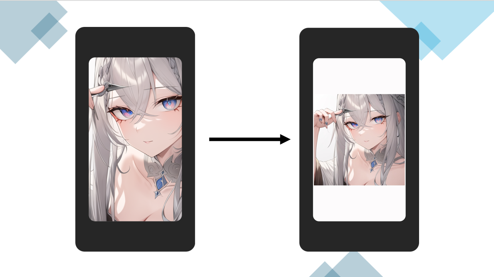

# BgGapFiller

壁紙にしたい画像の縦横比がスマホやタブレットの画面と合わないときに、足りない部分を画像でいちばん多く使われている色で埋めて、その端末の画面比率に合った壁紙を作る Web アプリです。

- デモ: https://bggapfiller.onrender.com/
  - 無料プランで動かしているため、しばらくアクセスがないと最初の表示に 30 秒〜1 分ほどかかります。
- 開発: 個人開発（2023年8月）

<!-- TODO: スクリーンショットか GIF を入れる（元画像 → 生成画像の比較があると一目で伝わる） -->
<!--  -->


## 作った理由
当時のiOSでは、気に入った画像をスマホの壁紙にすると、端末の画面比率と合わずに上下や左右が切り取らなければなりませんでした。

画像編集アプリで余白を足せば直せますが、毎回色を選んで比率を計算するのは面倒です。

画像と端末を選ぶだけで済むようにしたくて作りました。

## 使い方

1. 壁紙にしたい画像を選ぶ
2. 端末を選ぶ（iPhone、Pixel、Galaxy、iPad など 14 機種）か、画面の横×縦を直接入力する
3. 送信すると、その端末の画面比率に合わせて余白を足した画像が表示される

## 仕組み

```
ブラウザ (HTML / CSS / JavaScript)
  │  fetch で画像 + 端末の横幅・縦幅を POST（画面遷移なし）
  ▼
FastAPI (POST /api/generate)
  ※ OpenCV の処理はスレッドプールで実行し、処理中も他のリクエストに応答できるようにしている
  1. OpenCV で画像を読み込む（透過 PNG・グレースケール・16bit 画像も 8bit の BGR にそろえる）
  2. 画像と端末の縦横比を比べて、縦か横のどちらを伸ばすか決める
  3. 画像中で最も多く使われている色（最頻色）を求める
  4. 最頻色で塗りつぶしたキャンバスの中央に元画像を配置する
  5. JPEG にエンコードして image/jpeg で返す（不正な入力には 400 とエラーメッセージを返す）
  ▼
同じ画面に生成画像のプレビューと「画像を保存」ボタンを表示
```

- 元画像の画素は拡大・縮小せず、そのまま使います。足りない方向にだけ余白を足すので、画質は落ちません。
- 生成した画像はサーバーに保存せず、レスポンスとして返して終わりにしています。アップロードされた画像がサーバーに残らないので、画像の削除や管理の仕組みが要りません。
- 機種を選ぶと画面サイズのフォームに値が自動で入ります。一覧にない端末でも、数値を書き換えればそのまま使えます。

## 技術スタック

| 役割 | 技術 |
| --- | --- |
| フロントエンド | HTML / CSS / JavaScript |
| バックエンド | Python / FastAPI / Jinja2 |
| 画像処理 | OpenCV / NumPy |
| ホスティング | Render（`render.yaml` で設定を管理） |

画像処理を Python のライブラリで書きたかったので FastAPI、無料で Python の Web サービスを公開できるので Render を使用。

## ローカルで動かす

```bash
pip install -r requirements.txt
uvicorn main:app --reload
# http://localhost:8000 を開く
```

テスト:

```bash
pip install -r requirements-dev.txt
pytest
```

## 今後の改善

今の実装で分かっている課題と、直したいことです。

- **余白の色の決め方**: 今は画像全体の最頻色を使っているため、縁の色と違う色が選ばれて境目が目立つことがあります。画像の端の画素だけで色を決める方法に変えたいです。
- **元画像を縮小するオプション**: 今は元画像の解像度のまま余白を足すので、高解像度の画像だと出力ファイルも大きくなります。端末の解像度に合わせて縮小する選択肢を付けたいです。
